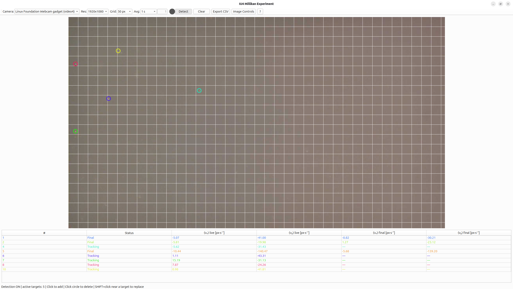

# IU4 Millikan Experiment

Small PyQt/OpenCV application for the **IU4 Millikan oil-drop experiment** at AP Uni Basel. It shows a live camera image, lets the user select one or several oil droplets, tracks them automatically, computes their velocities in px/s, records MP4 videos, and exports the final mean velocities to CSV.

Manual context: [AP Uni Basel IU4 manual](https://ap.physik.unibas.ch/PDF/Manuals/English/IU4en.pdf)



## Camera compatibility

The program should work with **any USB camera** that is visible to Linux as a video device, for example `/dev/video0`, `/dev/video2`, etc. It is not specific to the camera shown in the screenshot. Internally it uses OpenCV `VideoCapture` and tries to list external cameras through `/dev/v4l/by-id` or `v4l2-ctl`.

## Installation (Ubuntu 26.04 LTS — all lab users)

This is the **only supported installation method**. It installs IU4 Millikan system-wide under `/opt/iu4-millikan` with its own Python virtual environment and a launcher in the Applications menu. **All users of the computer can run the application without administrator rights.** On Ubuntu GNOME, it also pins the application to the **Dock of the user running the installation** without removing any existing favorites. Other users can launch it from the Applications menu and pin it to their own Dock if desired.

Open a terminal as a normal desktop user (not `root`), then **copy and paste the entire block**. You will be asked for your sudo password. Re-running this block also refreshes an existing installation from GitHub.

```bash
bash <<'INSTALL_IU4'
set -euo pipefail

sudo apt update
sudo apt install -y git python3-venv python3-pip v4l-utils libgl1 libglib2.0-0 libxcb-cursor0 desktop-file-utils

# Download a fresh copy from GitHub; remove the temporary download on exit.
tmp_dir="$(mktemp -d)"
trap 'rm -rf "$tmp_dir"' EXIT
git clone --depth 1 https://github.com/maxlpld/iu4-milikan.git "$tmp_dir/iu4-milikan"

# Install for all users, replacing only the previous IU4 installation.
sudo rm -rf /opt/iu4-millikan
sudo install -d -m 755 /opt/iu4-millikan
sudo install -m 644 "$tmp_dir/iu4-milikan/iu4millikan.py" "$tmp_dir/iu4-milikan/README.md" "$tmp_dir/iu4-milikan/icon.png" "$tmp_dir/iu4-milikan/Screenshot-IU4.png" /opt/iu4-millikan/
sudo install -m 755 "$tmp_dir/iu4-milikan/run.sh" /opt/iu4-millikan/run.sh

# Isolated Python environment: do not install pip packages into system Python.
sudo python3 -m venv /opt/iu4-millikan/venv
sudo /opt/iu4-millikan/venv/bin/python -m pip install --upgrade pip
sudo /opt/iu4-millikan/venv/bin/python -m pip install opencv-python PyQt6 numpy
sudo chmod -R a+rX /opt/iu4-millikan

# Desktop application available to everyone on this computer.
sudo tee /usr/share/applications/iu4-millikan.desktop >/dev/null <<'DESKTOP_ENTRY'
[Desktop Entry]
Name=IU4 Millikan Experiment
Comment=Oil Drop Experiment Application
Exec=/opt/iu4-millikan/run.sh
Icon=/opt/iu4-millikan/icon.png
Terminal=false
Type=Application
Categories=Education;Science;
DESKTOP_ENTRY
sudo update-desktop-database

# Add it to the CURRENT user's Ubuntu GNOME Dock, preserving other favorites.
if command -v gsettings >/dev/null 2>&1 && [[ "${XDG_CURRENT_DESKTOP:-}" == *GNOME* ]]; then
    current_favorites="$(gsettings get org.gnome.shell favorite-apps)"
    updated_favorites="$(FAVORITES="$current_favorites" python3 - <<'PYTHON'
import ast
import os
favorites = ast.literal_eval(os.environ["FAVORITES"].removeprefix("@as "))
if "iu4-millikan.desktop" not in favorites:
    favorites.append("iu4-millikan.desktop")
print(repr(favorites))
PYTHON
)"
    gsettings set org.gnome.shell favorite-apps "$updated_favorites"
fi

echo "IU4 Millikan installed. Launch from the Dock / Applications menu."
INSTALL_IU4
```

The launcher uses `/opt/iu4-millikan/run.sh`. You can also start it manually:

```bash
/opt/iu4-millikan/run.sh
```

### Camera troubleshooting

If the camera is not detected, unplug and reconnect it, then check:

```bash
v4l2-ctl --list-devices
```

If your user lacks permission to access the camera, run the following once and **log out and back in** to apply the group change:

```bash
sudo usermod -aG video "$USER"
```

## Uninstall

Copy and paste the entire block to remove the application, desktop launcher, and its entry from the **current user's** GNOME Dock. It leaves experimental CSV/video data in your home folder untouched.

```bash
bash <<'UNINSTALL_IU4'
set -euo pipefail

# Unpin for the current user without changing their other Dock favorites.
if command -v gsettings >/dev/null 2>&1 && [[ "${XDG_CURRENT_DESKTOP:-}" == *GNOME* ]]; then
    current_favorites="$(gsettings get org.gnome.shell favorite-apps)"
    updated_favorites="$(FAVORITES="$current_favorites" python3 - <<'PYTHON'
import ast
import os
favorites = ast.literal_eval(os.environ["FAVORITES"].removeprefix("@as "))
print(repr([app for app in favorites if app != "iu4-millikan.desktop"]))
PYTHON
)"
    gsettings set org.gnome.shell favorite-apps "$updated_favorites"
fi

sudo rm -rf /opt/iu4-millikan
sudo rm -f /usr/share/applications/iu4-millikan.desktop
sudo update-desktop-database
echo "IU4 Millikan uninstalled (saved experimental data preserved)."
UNINSTALL_IU4
```

## How to use

1. Select the USB camera and the resolution.
2. Adjust brightness, contrast, or gamma only if the droplets are difficult to see.
3. Click **Detect**.
4. Click on an oil drop to track it. Several drops can be tracked at the same time.
5. Click on a colored circle to delete that target.
6. Use **Export CSV** to save the final mean velocities.
7. Use the red record button to save a video of the experiment.

## How the oil drops are detected and tracked

The user first selects a visible oil drop by clicking on it in the video. After this first manual selection, the program follows the drop automatically from frame to frame.

At each frame, the program looks only in a small square region around the previous drop position $(x_{k-1}, y_{k-1})$. This makes the tracking more stable, because the program does not need to search the whole image.

The selected region is converted to grayscale. A blurred version of this grayscale image is then computed to estimate the local background. The drop is highlighted by subtracting this smooth background from the original grayscale image:

$$
H(x,y) = |I(x,y) - G(x,y)|
$$

Here, $I(x,y)$ is the grayscale image and $G(x,y)$ is the blurred local background. Taking the absolute value makes both bright and dark oil drops visible.

The high-pass image is then converted into a binary mask using Otsu thresholding:

$$
M(x,y) =
\begin{cases}
1, & H(x,y) > T_\mathrm{Otsu} \\
0, & \text{otherwise}
\end{cases}
$$

Pixels with value $1$ belong to detected objects, while pixels with value $0$ are ignored.

Small noise blobs and very large reflections are removed using an area filter. For each remaining blob, the center position is computed from image moments:

$$
x_c = \frac{M_{10}}{M_{00}}
$$

$$
y_c = \frac{M_{01}}{M_{00}}
$$

Among all valid blobs, the program keeps the one closest to the previous drop position. If the displacement is too large, the detection is rejected, because it is probably not the same drop.

Finally, the detected position is smoothed to reduce camera noise:

$$
\mathbf r_k = \alpha \mathbf r_{k-1} + (1-\alpha)\mathbf r_\mathrm{det}
$$

In the current code, the smoothing parameter is:

$$
\alpha = 0.65
$$

Tracking stops automatically if the drop is lost for several frames or if it reaches the image border.

## Velocity, mean velocity, and error estimate

For each frame, the program compares the new position with the previous one:

$$
\Delta x_k = x_k - x_{k-1}, \qquad
\Delta y_k = y_k - y_{k-1}, \qquad
\Delta t_k = t_k - t_{k-1}.
$$

The instantaneous velocities are then

$$
v_{x,k} = \frac{\Delta x_k}{\Delta t_k}, \qquad
v_{y,k} = \frac{\Delta y_k}{\Delta t_k}.
$$

The unit is **px/s**. The sign is corrected if the camera image is rotated by 180°.

The live mean velocity shown in the table is the average over the selected time window:

$$
\langle v_x \rangle_\mathrm{live} = \frac{1}{n}\sum_{k=1}^{n} v_{x,k}, \qquad
\langle v_y \rangle_\mathrm{live} = \frac{1}{n}\sum_{k=1}^{n} v_{y,k}.
$$

When the drop leaves the frame or is lost, the final mean velocity is computed from all stored velocity samples:

$$
\bar v_x = \frac{1}{N}\sum_{k=1}^{N} v_{x,k}, \qquad
\bar v_y = \frac{1}{N}\sum_{k=1}^{N} v_{y,k}.
$$

For the uncertainty of a mean velocity, use the standard error of the mean:

$$
s_v = \sqrt{\frac{1}{N-1}\sum_{k=1}^{N}\left(v_k - \bar v\right)^2},
\qquad
\sigma_{\bar v} = \frac{s_v}{\sqrt{N}}.
$$

This error estimates how much the mean velocity fluctuates because of frame-to-frame tracking noise. In the current version, the GUI displays and exports the final mean velocities; if an error column is needed for the report, compute it from the stored velocity samples using the formula above or add it to the exporter.

All positions are measured in pixels. To convert to physical units, a calibration factor is required:

$$
v_\mathrm{phys} = v_\mathrm{px/s}\,c,
$$

where $c$ is the physical length per pixel.

## Data saving and export

### CSV export

Click **Export CSV** to save the final mean velocities. The default folder is

```text
~/Documents/IU4MillkanExp/
```

The exported file contains one line per tracked drop:

```csv
id,mean vx [px/s],mean vy [px/s]
1,-5.07,-41.00
2,-5.81,-19.98
```

If a drop is still being tracked and has no final value yet, the corresponding CSV entries are left empty.

### Video recording

Click the red record button to start or stop recording. Videos are saved as MP4 files in

```text
~/Documents/IU4MillkanExp/
```

The recorded video includes the grid and the tracked targets. Live or final velocity values are written on the video overlay when available.

